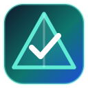

  <section class="prisma-hero">
    
    

      UnB • FGA0173 IHC 2026.2 • Grupo 10
      <h1>PrismaIHC — Guia de Concepção &amp; Checklist de Auditoria Web</h1>
      

        Plataforma interativa de <strong>UX, IHC e Acessibilidade Digital</strong> estruturada em duas frentes complementares:
        <strong>📖 Guias Metodológicos</strong> para concepção centrada no humano (Total X, Personas, Blueprints e Figma) e
        <strong>📋 Checklists de Auditoria Web</strong> com <strong>69 critérios práticos</strong> aplicáveis a qualquer site no ar
        (WCAG 2.2, ABNT NBR 17225:2025, NBR 17060, W3C COGA, Nielsen e Linguagem Simples).
      

      

        <a href="02-jornadas-blueprints/user-journey-vs-flows.html" class="prisma-btn prisma-btn--primary">▶ Iniciar Auditoria Web</a>
        <a href="01-totalx-personas/total-experience.html" class="prisma-btn">📖 Guias Metodológicos</a>
        <a href="05-ferramentas/comparativo-ferramentas.html" class="prisma-btn">🛠️ Ferramentas</a>
        <button type="button" id="prisma-export-global" class="prisma-btn">📥 Exportar Relatório Geral (.md)</button>
      

    

  </section>

  <section>
    

      

        <h2>Painel Geral da Auditoria Web (69 Critérios)</h2>
        
          Calculado automaticamente sobre os critérios aplicáveis marcados nos checklists (salvo localmente no navegador). Itens <strong>N/A</strong> saem do denominador.
        
      

      <button type="button" id="prisma-reset-all" class="prisma-btn">↺ Zerar progresso</button>
    

    

      

        
          Conformidade Geral
        
        

          <svg width="156" height="156" viewBox="0 0 120 120" role="img" aria-label="Gráfico Donut de Conformidade Geral">
            <circle cx="60" cy="60" r="48" fill="none" stroke="rgba(148,163,184,0.22)" stroke-width="11"></circle>
            <circle id="prisma-main-donut-ring" cx="60" cy="60" r="48" fill="none" stroke="#0d9488" stroke-width="11"
              stroke-linecap="round" stroke-dasharray="301.59" stroke-dashoffset="301.59" class="prisma-donut-ring"></circle>
          </svg>
          

            0%
            0 / 0 aplicáveis
          

        

        

          <strong id="prisma-main-done" style="color: #10b981;">0</strong> ✅
          <strong id="prisma-main-fail" style="color: #ef4444;">0</strong> ❌
          <strong id="prisma-main-na" style="color: var(--prisma-muted);">0</strong> N/A
          <strong id="prisma-main-pend" style="color: #d97706;">0</strong> Pendentes
        

      

      

    

  </section>

  <section>
    

      

        <h2>📖 Guias Metodológicos de Concepção, Projeto &amp; Ferramentas</h2>
        
          Referências de processo para orientar descoberta, redesenho pós-auditoria, prototipação acessível e escolha de ferramentas (sem checkboxes).
        
      

    

    

      

        <h3 class="prisma-card-heading--teal">1 • Descoberta &amp; Empatia</h3>
        Total Experience, Canvas &amp; Personas
        
Integração entre UX, CX, EX e TX, uso de Mapas de Empatia e Canvas com pessoas reais, catálogo dos 11 perfis funcionais de filtro e Personas Ecossistêmicas.

        
<a href="01-totalx-personas/total-experience.html"><strong>Acessar guias de Total X &amp; Personas →</strong></a>

      

      

        <h3 class="prisma-card-heading--purple">2 • Serviço &amp; Prototipação</h3>
        Mapeamento As-Is → To-Be &amp; Figma
        
Como transformar falhas da auditoria em melhorias de serviço (Kalbach) e documentar foco, estados de erro, variantes e ordem de Tab no handoff do Figma.

        

          <a href="02-jornadas-blueprints/blueprint-situacoes-kalbach.html"><strong>Guia As-Is → To-Be</strong></a> •
          <a href="03-cognicao-ui-figma/ui-prototipacao-figma.html"><strong>Guia de Figma</strong></a>
        

      

      

        <h3 class="prisma-card-heading--amber">3 • Bancada de Testes</h3>
        Comparativo &amp; Tutoriais das Ferramentas
        
Matriz de seleção das 11 ferramentas dos filtros de auditoria web (Inspeção Manual, Teclado, DevTools, Axe, WAVE, Lighthouse, Insights, CCA, ASES, NVDA e TalkBack) + pré-código no Figma.

        
<a href="05-ferramentas/comparativo-ferramentas.html"><strong>Explorar ferramentas e tutoriais →</strong></a>

      

    

  </section>

## Evolução do Guia — O Que Há de Novo no PrismaIHC e Fontes

Em evolução aos guias *Pocket* anteriores da disciplina FGA0173 (IHC/UnB), o **PrismaIHC** atualiza o referencial normativo brasileiro e internacional e conecta a avaliação técnica de acessibilidade aos fundamentos de UX e Design de Serviço:

| Frente Incorporada | O que há de novo no PrismaIHC | Referência Normativa / Acadêmica de Origem |
| :--- | :--- | :--- |
| **Normas Brasileiras (2025 e 2022)** | Adoção da primeira norma técnica brasileira específica de acessibilidade web (requisitos, recomendações e Anexos A/B/C) combinada à norma de acessibilidade móvel. | **ABNT NBR 17225:2025**; **ABNT NBR 17060:2022**; **LBI** (Lei nº 13.146/2015, art. 63); **eMAG 3.1** (Gov.br, 2014). |
| **Atualização para WCAG 2.2** | Inclusão dos **9 novos critérios** em relação à WCAG 2.1: foco não encoberto (`2.4.11`/`2.4.12`), aparência do foco (`2.4.13`), alternativa ao arrastar (`2.5.7`), alvo mínimo 24×24 px (`2.5.8`), ajuda consistente (`3.2.6`), sem entrada redundante (`3.3.7`) e autenticação sem teste cognitivo (`3.3.8`/`3.3.9`). | **W3C WCAG 2.2** (2023); Correspondência WCAG 2.2 ↔ NBR 17225 (**Ceweb.br**, Marques, Deus & Ferraz, 2025). |
| **Linguagem Simples & Cognição** | Critérios voltados à carga cognitiva, atenção, memória, neurodivergência e clareza textual segundo o marco legal brasileiro recém-sancionado. | **Lei nº 15.263/2025** (Política Nacional de Linguagem Simples); **ABNT NBR ISO 24495-1:2024**; **W3C COGA** (*Making Content Usable*, 2021). |
| **Heurísticas & Relatório Fundamentado** | Avaliação das 10 Heurísticas integrada ao registro de **Severidade (1 a 4)**, opção **N/A** e exportação imediata de tabela fundamentada em Markdown para laudos técnicos. | **Nielsen** (1994, *10 Usability Heuristics*; 1995, *Severity Ratings*); **Barbosa et al.** (*IHC e UX*, 2021). |
| **Concepção IHC, Fluxos & Serviços** | Separação clara entre guias de concepção interna (*Total X*, *Canvas*, *Personas Inclusivas/Ecossistêmicas*, *Figma*) e auditoria de fluxos, omnicanalidade e reflexos de bastidores no site. | **ABNT NBR ISO 9241-210**; **Gartner** (Total X, 2020); **Kalbach** (*Mapeamento de Experiências*, 2017); **Morgan & Miller** / **Stickdorn et al.** (2019); **Guia Gov.br** (Diniz et al., 2023). |
