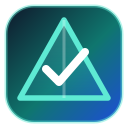

  <section class="prisma-hero">
    
    

      UnB • FGA0173 IHC 2026.2 • Grupo 10
      <h1>PrismaIHC — Guia Prático de Auditoria em UX, IHC &amp; Acessibilidade</h1>
      

        Um guia interativo completo para projetar e auditar produtos digitais: integrando
        <strong>Total Experience (CX, UX, EX, TX)</strong>, <strong>Design Empático</strong>,
        <strong>Personas &amp; Personas Ecossistêmicas</strong>, <strong>User Journeys × Flows</strong>,
        <strong>Service Blueprints</strong> e <strong>Omnicanalidade</strong> com
        <strong>Acessibilidade Cognitiva</strong>, <strong>Heurísticas</strong>,
        <strong>Prototipação no Figma</strong>, <strong>WCAG 2.2</strong> e as normas
        <strong>ABNT NBR 17225:2025</strong> e <strong>NBR 17060</strong>.
      

      

        <a href="01-totalx-personas/total-experience.html" class="prisma-btn prisma-btn--primary">▶ Iniciar Auditoria</a>
        <a href="05-ferramentas/comparativo-ferramentas.html" class="prisma-btn">🛠️ Guia de Ferramentas</a>
        <button type="button" id="prisma-export-global" class="prisma-btn">📥 Exportar Relatório Geral (.md)</button>
      

    

  </section>

  <section>
    

      

        <h2>Painel Geral de Progresso (Donuts SVG)</h2>
        
          Calculado automaticamente a partir dos critérios marcados em cada eixo temático (salvo no navegador).
        
      

      <button type="button" id="prisma-reset-all" class="prisma-btn">↺ Zerar progresso</button>
    

    

      

        
          Índice Geral da Auditoria
        
        

          <svg width="160" height="160" viewBox="0 0 120 120" role="img" aria-label="Gráfico Donut de Progresso Geral">
            <circle cx="60" cy="60" r="48" fill="none" stroke="rgba(148,163,184,0.22)" stroke-width="11"></circle>
            <circle id="prisma-main-donut-ring" cx="60" cy="60" r="48" fill="none" stroke="#0d9488" stroke-width="11"
              stroke-linecap="round" stroke-dasharray="301.59" stroke-dashoffset="301.59" class="prisma-donut-ring"></circle>
          </svg>
          

            0%
            0 / 0 critérios
          

        

        

          <strong id="prisma-main-done" style="color: #0d9488;">0</strong> Atendidos
          •
          <strong id="prisma-main-pend" style="color: #d97706;">0</strong> Pendentes
        

      

      

    

  </section>

  <section class="prisma-steps-grid">
    

      1 • EIXOS TEMÁTICOS DE IHC
      <h3>Navegue por etapa do projeto</h3>
      
Da descoberta com Total X, Personas e Blueprints até a prototipação no Figma e validação com NBR 17225 e WCAG 2.2.

    

    

      2 • SMART BADGES &amp; COMO AUDITAR
      <h3>Filtre por Persona, Norma ou Ferramenta</h3>
      
Cada critério traz etiquetas clicáveis e um passo a passo recolhido explicando exatamente como inspecionar o item.

    

    

      3 • FERRAMENTAS &amp; RELATÓRIO
      <h3>Consulte tutoriais e exporte o resumo</h3>
      
Veja comentários críticos de testes práticos das ferramentas e gere o diagnóstico em Markdown com 1 clique.

    

  </section>

